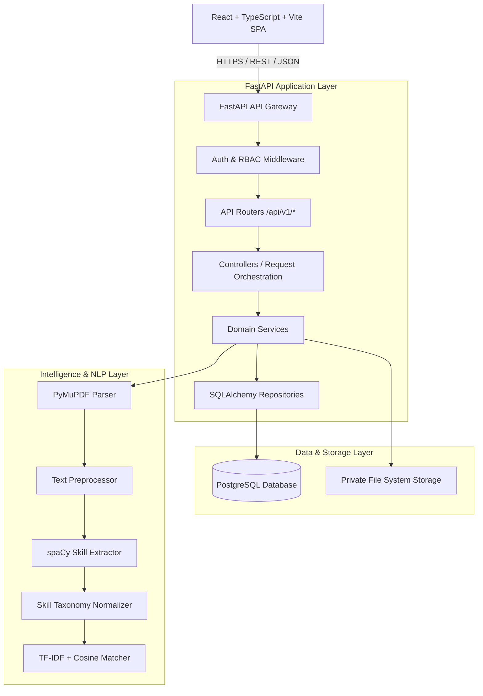
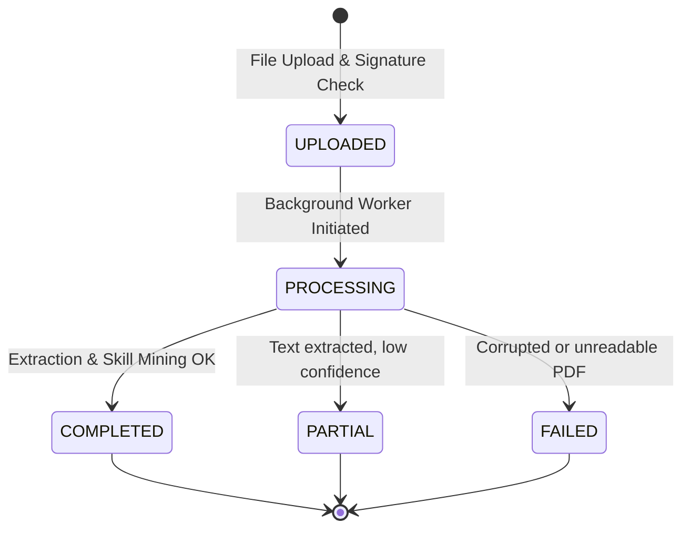

# Phase 02: System Architecture & Technical Design

## 1. Objectives
- Detail the layered architecture: Presentation, API, Business Logic, Data, and Intelligence layers.
- Formalize request lifecycle, error handling protocols, and background job processing pipelines.
- Generate architectural diagrams in Markdown/Mermaid format in `docs/architecture/`.

## 2. Generate Architecture Blueprint Document
Run the following PowerShell command to generate `docs\architecture\ARCHITECTURE.md`:

```powershell
Set-Content -Path "docs\architecture\ARCHITECTURE.md" -Value @"
# TalentBridge - System Architecture & Technical Design

## 1. High-Level Architecture Flowchart



## 2. Layered Structure & Package Boundaries
1. **Presentation Layer (React SPA):**
   - Pure UI components, route views, context providers, and typed API clients.
2. **API Layer (`backend/app/routes`):**
   - Defines HTTP routes, Swagger schemas, and dependency injections.
3. **Controller & Service Layer (`backend/app/services`):**
   - Implements business logic, validation rules, and transaction coordination.
4. **Repository Layer (`backend/app/repositories`):**
   - Encapsulates database queries using SQLAlchemy ORM.
5. **Intelligence Layer (`backend/app/ml`):**
   - Standalone, testable modules for document extraction, skill mining, vectorization, and explainable scoring.
6. **Storage Layer:**
   - Private filesystem directory with hashed storage keys (e.g. `UUID4.pdf`).

## 3. Resume Processing Pipeline (State Machine)

"@
```

## 3. Phase 02 Acceptance Criteria Check
- [x] Architecture document created with clear layer boundaries.
- [x] Request lifecycle and state machine defined.

